# multi-search-skill

[](LICENSE)
[](https://www.python.org/downloads/)

并行聚合搜索 skill + 共享 Core：搜索结果统一按 RRF 排序，取前 15 条后自动获取正文并返回预览；子代理只排除明确无关项，其余结果连同原始预览交给主 Agent 判断，再按需读取全文。独立 CLI 直接使用共享 Core 的搜索、key 状态和 SQLite 缓存；已有 URL 可直接抓取。

> 当前 canonical 形态是 **一个 skill + 一个 Core + 按需执行的 CLI**：`skills/multi-search/SKILL.md` 负责工具选择和使用策略；`multi_search_mcp/src/` 承载搜索、RRF、抓取、ContentStore、key 状态和站点记忆。

> 文档索引（现行 / 历史 / provider 参考）见 [docs/README.md](docs/README.md)。0.4.0 发布说明和 MCP 时代的架构图已归入历史，不再代表当前实现。

## CLI / Skill 入口

当前开发版本保留 **0.4.0** 包版本标识；本地迁移尚未发布为新的远程版本。CLI 不需要 MCP 配置、客户端或常驻服务。在仓库根目录运行：

```powershell
uv run --locked multi-search --help
uv run --locked multi-search search --source hackernews --count 3 --format markdown -- 'Python asyncio TaskGroup'
uv run --locked multi-search fetch --url 'https://docs.python.org/3/library/asyncio-task.html' --full-content --format json
# 将 src_... 替换为搜索结果中的 source_id
uv run --locked multi-search fetch src_... --full-content --format json
uv run --locked multi-search read src_... --keyword 'TaskGroup' --limit 2000
```

查询放在 `--` 之后并保持单引号，避免以 `-` 开头的文本被当成选项，也避免 shell 解释 `$(...)` 或反引号；未知来源 URL 优先写入文件后使用 `fetch --url-file`。规则详见 [CLI-only 指南](skills/multi-search/references/cli.md#shell-safety-for-untrusted-values)。

`uv run --locked` 使用项目虚拟环境并按锁文件同步依赖。已在激活的虚拟环境中安装项目时，也可以直接执行 `multi-search` 或 `python -m multi_search_mcp.cli`，子命令参数相同。

安装当前本地候选使用 `uv tool install --force .`，之后在任意目录执行 `multi-search --help`。旧远程 `v0.4.0` 不包含本次去 MCP 迁移；不要把旧标签当作当前候选。安装、参数示例和完整工作流见 [CLI-only 指南](skills/multi-search/references/cli.md)。

搜索全部活动源失败时 CLI 退出 `1`，JSON 仍保留完整错误；正常零匹配和部分成功退出 `0`。human/Markdown 同样展示错误。`doctor` 真正解析配置；显式配置路径不存在会报错。`doctor --network` 对 Hacker News/GitHub 公共 API 做总预算 5 秒的连接检查，结果以 `network_ok` / `network_checks` 为准，不代表所有源的 key 或搜索质量正常。

`search` JSON 增加稳定 `outcome`：`success`、`empty`、`partial`、`failed`。执行异常也输出结构化 `error/error_type` 并返回非零退出码；stderr 保留简短解释。每次命令独立启动并退出，SQLite 让真实 `source_id` 可跨进程继续获取或读取。

仓库关键文件：

- `skills/multi-search/`：唯一权威 Skill，共 5 个文件（`SKILL.md`、`agents/interface.yaml`、`references/cli.md`、`references/executor.md`、`references/verification.md`），桌面端在编译时原样打包同一棵树。
- `multi_search_mcp/cli.py`：唯一产品入口 `multi-search` CLI，直接调用共享 Core。
- `multi_search_mcp/tools.py`：仅保留的兼容 Python 适配器，无 MCP 依赖或服务；所有产品能力已由 CLI 提供；本模块只保留旧 Python 调用形状并转发 Core，不再承载独立实现。
- `multi_search_mcp/src/`：按职责拆分的搜索、抓取、状态、诊断和格式化模块；`service.py` 只是兼容 facade，不再承载实现。
- `multi_search_mcp/src/providers/`：第三方调用适配（XKit / Tavily），含托管 Twitter Cookie 的运行时装配；搜索器和抓取器通过这里取得客户端。
- `multi-search-config.json`：仓库开发用的非敏感示例/默认配置。

CLI 子命令是 `search`、`fetch`、`read`、`doctor`、`sources`、`keys status|reset`、`site stats|set-preference|reset` 和 `migrate-legacy plan|apply`。Core 中 `multi_search` / `scrape_url` 等兼容 Python 能力仍保留，但只作为 CLI/Core 之上的薄包装。历史包名 `multi-search-mcp` / `multi_search_mcp` 为兼容安装和导入而保留，不表示需要 MCP 组件。

边界约定：凭据按 **环境变量（`env`）> Windows 凭据库（`credential_store`）> `~/.search-keys.json`（`keys_file`）** 解析，其中 Windows 凭据库是 `~/.multi-search/config.sqlite` 内以当前用户 DPAPI 加密的条目；非敏感行为配置按 `MULTI_SEARCH_CONFIG` → `config.sqlite` 的 settings 记录（桌面端写入，存在即权威）→ `~/.multi-search/multi-search-config.json` → 仓库开发态的 `multi-search-config.json` 读取；运行状态默认保存在 `~/.multi-search/state.sqlite`。CLI 不需要任何 MCP 客户端启动配置。

当前默认行为：`search_web` 使用 `default`（`web` 的兼容别名），全部有效候选参与 RRF，最终取前 15 条并获取正文。`results[].content` 保留摘要，正文预览只在 `scrapes[].markdown` 返回，按 `source_id` 关联，默认每篇最多 1200 字符。需要截断时，预览从与结果标题完全匹配的页面一级标题开始，没有匹配标题时可定位逐字匹配完整搜索摘要的段落（至少 32 个非空白字符，仅允许空白差异），仍无匹配则从正文开头开始；`preview_start/end` 标注原文字符区间（左闭右开），省略前文也标记 `truncated`。完整正文与缓存保持原样。支持委派时，由宿主配置的轻量子代理执行搜索，只排除明确无关项，保留全部相关或不确定候选及原始预览，不限定保留数量。主 Agent 看预览做最终筛选，按需调用 `fetch_source(source_id=..., full_content=True)` 读取全文；宿主没有子代理能力或用户要求直接执行时，由主 Agent 执行同一流程。Core 继续抓取最终 15 条并按策略缓存，选读不改变排序或抓取数量，也不引入服务端 AI 选择器、摘要或智能摘录。旧 `scrape_top` / `scrape_per_source` 请求参数已移除；配置文件中的同名键（以及 `no_scrape`、`brief`、`verbose`、`title_url_only`、`want_content`）会被忽略并给出弃用警告（`FutureWarning`）。

## Windows 桌面管理（本地开发候选）

`desktop/` 是 Tauri 2 管理台，共 8 个页面，负责本机 CLI、Skill、凭据、搜索与抓取配置；它不提供搜索 UI，也不修改系统级设置。设置和凭据保存在与 CLI 共用的 `~/.multi-search/config.sqlite`。

| 页面 | 能力 |
|---|---|
| 01 概览与测试 | 检测应用继承的 PATH、已登记的用户 PATH（Windows 为注册表，macOS 为本工具追加到登录 Shell 配置的受管区块）中的 CLI（Windows `multi-search.exe`／macOS `multi-search`），显示版本、实际路径和来源；运行或取消一次测试搜索，结果以结构化列表展示，来源错误单列，原始 JSON 折叠保留。新终端可发现不意味着已打开的终端或 Agent 已刷新环境。 |
| 02 安装 CLI | 从应用资源内的受控 bundle 安装、更新或卸载 CLI：Windows 到 `%LOCALAPPDATA%\MultiSearch\cli`，macOS 到 `~/Library/Application Support/MultiSearch/cli`；先把 manifest 原始字节与编译进二进制的 SHA-256 锚点比对，再逐个核对文件大小和哈希。未知安装不覆盖，失败不动已有可用版本。加入用户 PATH 需单独确认：Windows 写当前用户 PATH，macOS 只在登录 Shell 配置末尾追加带标记的区块，新开终端才生效，已运行的宿主需重启。 |
| 03 Claude Code Skill | 以全局或项目范围安装、更新、移除受管的 `multi-search` Skill；写入前检查目标目录和 CLI 是否支持所需的子命令与参数，更新前备份本地修改并要求显式确认；不覆盖非本工具安装的 Skill。 |
| 04 搜索源与凭据 | 列出 12 个搜索源及启用状态，另含仅用于抓取的 Jina；Key 保存在 Windows 凭据库（`config.sqlite` 中按 provider 一行、当前用户 DPAPI 加密），可保存、删除并向对应服务商发送一次测试请求；Jina 可维护静态 `exhausted` 标记。不显示已保存的 Key，测试可能消耗额度。 |
| 05 搜索设置 | 读写默认路由、全局超时（1–60 秒）和路由组：可新建、编辑、复制、删除分组（标识、名称、搜索源、可继承的独立超时），或恢复内置五组；分组以卡片列出，编辑器在该卡片下就地展开，搜索源支持全选、全不选与反选批量勾选；全局禁用的搜索源保留为组员但执行时跳过。另可填写 Twitter Cookie 文件兼容路径（仅 file 模式读取），并显示配置数据库路径与来源；配置无法读取时禁止保存。 |
| 06 抓取设置 | 编辑通用网页抓取的 fallback 顺序（抓取链，`jina`/`exa`/`tavily`/`firecrawl` 的有序子集，可停用、恢复默认顺序）；查看站点抓取记忆（各后端成功/失败/拦截/超时、冷却与手动偏好），可为站点固定后端或按站点重置。Reddit / Twitter 按域名固定使用专用抓取器，不受抓取链影响。 |
| 07 Cookie 托管 | 显示 Twitter/X Cookie 当前模式；用户显式确认后把 Cookie 文件导入为当前用户 DPAPI 加密的托管条目（切换到 `managed`），或删除托管 Cookie。导入和删除都不修改或删除原文件，本页不读取或显示 Cookie 内容；删除后仍保持 `managed` 且不可用，不回退旧文件。 |
| 08 旧配置迁移 | 预览并迁移 `~/.search-keys.json` 中的单 Key 条目到 Windows 凭据库；多 Key 列表、Jina、Cookie 对象和无法识别的条目保留在旧文件。预览只显示掩码指纹，迁移前逐项确认，旧文件永不删除，并在结果中提示残留明文和文件权限。 |

受管 CLI 与 Skill 都以“先校验、再写入”为前提：bundle 的信任锚是 `scripts/build_cli_bundle.py` 生成、由 `desktop/src-tauri/build.rs` 编译进二进制的 manifest SHA-256；Skill 以 `skills/multi-search/` 为唯一权威源，受管版本由打包内容哈希派生。桌面端只运行受管目录（验证通过时优先于 PATH 中的同名文件）或 PATH 中发现的 CLI，前端不能指定可执行路径；子进程只拿到非敏感的基础环境变量和本次所需的 key。取消/关闭只结束本次 Windows Job Object 归属的执行和子进程，独立终端 CLI 不受影响。

已有 Node、Rust/MSVC 与 WebView2 的 Windows 开发环境中：

```powershell
npm --prefix desktop ci
npm --prefix desktop run dev
# 原生测试与 DOM 测试分开，均不能代替真实窗口验收
cargo test --locked --manifest-path desktop/src-tauri/Cargo.toml --no-default-features --features test-fixtures,ts
npm --prefix desktop test
npm --prefix desktop run typecheck
```

桌面端输出当纯文本展示并脱敏。测试使用一次性 profile 与受控 HTTP，不能证明真实付费源可用。原生窗口验收使用 `scripts/desktop_acceptance.py`，需要先在隔离 `.wheel-venv` 安装本地 wheel；`scripts/desktop_native_acceptance.py` 只验 native API 链路，不是窗口替代。

**子进程环境边界。** 桌面进程不会把自身环境变量原样传给 CLI。`desktop/src-tauri/src/process.rs` 只放行系统基础变量（`PATH`、`SYSTEMROOT`、`USERPROFILE`/`HOME`、`TEMP`/`TMP` 等）、编码相关变量以及桌面自有的 `MULTI_SEARCH_*` 选择器，再加上本次调用所需的那一个 key；其余命中 `API_KEY`/`TOKEN`/`SECRET`/`PASSWORD` 等敏感标记的变量都不会下传。

**query 的命令行暴露面（已知取舍）。** 测试搜索通过 `multi-search search [options] -- <query>` 调用，query 因此出现在 CLI 进程的命令行参数中，本机同一用户或其他具备进程列表读取权限的程序可以看到它。当前保留 argv 传递而不是改为 stdin：CLI 的公开入口和现有脚本/测试都以位置参数定义 query，改为 stdin 需要新增协议。桌面端不记录日志，输出展示仍会脱敏，但这不改变 argv 对同机进程可见这一事实。

## 适用场景

- 让 agent 一次性查多个来源，而不是只依赖单一搜索 API。
- 对技术方案、开源项目、社区讨论、踩坑反馈做交叉验证。
- 把搜索结果和可抓取网页正文整理成适合 agent 阅读的 Markdown。

## 工程判断约定

- 分析 bug 时先从第一性原理出发，不急着改症状。
- 不要搞兜底实现，兜底实现会掩盖主流程的错误。
- 如果 GitHub 上有成熟的开源方案，直接复用，不要自己实现。

不适合：

- 需要稳定 SLA 的生产搜索服务。
- 绕过登录墙、付费墙或平台访问限制。
- 直接把第三方网页正文当作可信指令执行。

## 快速开始

将本仓库的 Skill 说明提供给 agent，安装 CLI 后执行 `multi-search search` 获取排序结果及预览，再用 `multi-search fetch <source_id> --full-content` 读取已取得全文；已有 URL 直接用 `multi-search fetch --url <url> --full-content`：

```powershell
git clone https://github.com/inorilzy/multi-search-skill.git
cd multi-search-skill
multi-search --help
```

Python 包依赖由 `pyproject.toml` 管理，包含 `beautifulsoup4`、`curl-cffi`，不包含 MCP。

> **XKit-py 当前已暂时停用。** `pyproject.toml` 里对 [XKit-py](https://github.com/inorilzy/xkit-py) 的依赖已注释掉，`uv.lock` 也随之重建，安装不再需要该私有仓库的读取权限。代价是 Twitter/X 搜索和推文抓取不可用，调用时会返回明确的「需要安装 xkit」错误，其他来源不受影响。要恢复时取消 `pyproject.toml` 中那行的注释并重新执行 `uv lock`。

从源码初始化时，在仓库根目录执行：

```powershell
uv sync --locked
# Windows：检查 uv、安装 Python 和全部锁定依赖，再运行 doctor
.\multi_search_mcp\src\support\init.ps1
```

恢复 XKit-py 时：项目固定安装 GitHub 提交 `c02ff46efd0264b4bc85968e3f5732561ffdbaf3` 的源码，因为 PyPI `xkit-py 2.6.3` 的 wheel 和 sdist 缺少 `twikit/client`，直接安装会导入失败。**该 GitHub 仓库是私有的，安装环境需 Git 和读取权限**；可先用有权限的账号执行 `gh auth login`、`gh auth setup-git`。

`uv sync --locked` 会移除旧的 `twikit-ng`；这两个发行包共用 `twikit` 模块目录，不应混装。使用已有 pip 环境升级时，先执行 `python -m pip uninstall twikit-ng`，再执行 `python -m pip install .`。

Twitter/X 除 cookies 外还需要 XKit-py（目前停用）。恢复后 XKit-py 首次请求会自动从 `x.com` 和 `abs.twimg.com` 获取运行参数，无需额外初始化命令或浏览器安装；网络连接失败、cookies 失效和限流会明确报错。

X 搜索只取得候选列表，返回 URL、标题、正文摘要和互动数据。统一去重、排序后，仅为最终入选的帖子调用 X 专用 scraper：通过 XKit `get_tweet_by_id()` 的 `.full_text` 读取正文，并加载最多 20 条评论（评论也读取 `.full_text`）。`x.com` / `twitter.com` 帖子链接可直接交给 `fetch_source`，无需先搜索；沿用同一份 Cookie，不切换到通用网页抓取器。正文进入统一缓存，后续短预览和 `read_source` 不会重新请求 X。旧版本的搜索片段缓存会在获取正文时重新抓取。

`.full_text` 保留 X 响应已经提供的长推文文本，不代表整串对话或全部评论。评论达到上限、仍有未加载评论或分页失败时，Markdown 会明确标注；`truncated` 仍表示已取得文本的输出裁剪，`full_content=True` 读取全部已取得文本。首次详情请求失败会作为抓取错误返回，并保留搜索候选。

Reddit 帖子抓取使用专用适配器，读取 Reddit 公开的帖子 JSON（`https://www.reddit.com/comments/{id}.json`），不申请 Token、不带 Cookie、不冒充官方客户端，以 `multi-search/1.0` 标识自身。`fetch_source`、`scrape_url` 和搜索后的正文抓取遇到 `reddit.com`（含子域）或 `redd.it` 时自动使用它，返回 `via`/`backend=reddit`；这些 URL 不进入通用后端链，即使抓取计划传入了通用 backends。其他域名沿用原有规则，Reddit 没有重新加入搜索源。

支持帖子/评论永久链接和 `redd.it/{post_id}`，正文与已加载评论输出为 Markdown，评论最多 100 条、8 层，并标注未展开部分。社区列表、wiki 和 `/s/` 分享跳转链接目前会明确报不支持。无需 Reddit 账号、Cookie、API key 或 Token。网络与其他 provider 走同一传输层：代理取自标准 `HTTP(S)_PROXY`/`ALL_PROXY`/`NO_PROXY`，不再读取非标准的 `PROXY`，重定向同样做目标校验。HTTP 拦截、限流或认证错误直接返回错误，不切换到通用 scraper。

## Agent 安装和使用

skill 入口在 [skills/multi-search/SKILL.md](skills/multi-search/SKILL.md)，可以作为 Claude Code / Codex 这类 agent 的技能说明入口。典型用法是让 agent 读取 skill 后执行：

```text
用 multi-search 查一下最近大家怎么评价某个 LLM 框架，重点看 GitHub、Twitter/X 和技术博客。
```

CLI 是薄入口，agent 按 `skills/multi-search/SKILL.md` 选择工作流；业务能力只落在 `multi_search_mcp/src/`。命令按需执行，无后台服务。历史架构审查文档仅记录过去的 MCP 形态，不是当前安装步骤；现行/历史文档分类见 [docs/README.md](docs/README.md)。

同步个人 Skill 时，将整个 `skills/multi-search/`（含 `references/` 与 `agents/`）复制到自己的 Skill 目录；先备份现有文件并保留个人定制，核对文件内容或 hash 后替换。只复制 `SKILL.md` 会缺少 CLI 指南与搜索执行器（委派、Claude Code / Codex / Pi 分派与交接）约定。已加载的旧 Skill 需要在新任务中重新读取。

`skills/multi-search/` 是仓库里唯一的 Skill 权威来源；桌面端在编译时把同一棵树原样打包进 `desktop/src-tauri/src/skill.rs`（`include_str!`），安装到受管目录的内容与这里一致，不再有第二份手写副本。Skill 内容一旦变化，受管版本的 `skill_version` 会随打包内容自动变化，桌面端据此提示更新。

## 搜索源、注册和免费额度

当前注册 12 个搜索源；`all` 路由包含全部 12 个。Jina 仅负责抓取正文，不计入搜索源。

源的名称、路由、别名、展示文案和环境变量名只由 Core 的 `multi_search_mcp/src/search/catalog.py` 维护。`multi-search sources --format json` 输出这份目录；桌面端构建时通过 `scripts/export_source_catalog.py` 生成并读取同一份目录，不再各自手抄。

免费额度来自当前公开页面或常见免费层，可能被服务商调整；以各平台控制台为准。

| 源 | 用途 | 注册地址 | 免费额度 / 说明 | 本地请求上限 |
|---|---|---|---|---:|
| Brave Search | Web 搜索，snippet，额外抓取优先源 | https://brave.com/search/api/ | 约 1,000 次/月；通常需要邮箱 + 信用卡 | 20 |
| Parallel Search | 语义 Web 搜索 + LLM 优化 excerpts | https://platform.parallel.ai/ | 使用 GA `/v1/search`；按请求计费，详见 [本地接入说明](docs/parallel/search.md) | 20 |
| Baidu AI Search | 中文 Web 搜索 + AI summary + 引用摘要 | https://cloud.baidu.com/product-s/qianfan_home | 千帆 / AppBuilder API；需要 `BAIDU_QIANFAN_API_KEY` 等 | 50 |
| Tavily | Web 搜索 + answer，可带 raw markdown，也是抓取后端 | https://tavily.com | 约 1,000 次/月；邮箱注册 | 20 |
| Exa | 搜索 + `contents.text`，也是抓取后端 | https://exa.ai | 约 1,000 次/月；邮箱注册 | 100 |
| Firecrawl | Web metadata search；抓取 backend | https://firecrawl.dev | 搜索仍需要 API key；`/v2/scrape` 无 key 可匿名使用但有 IP 级免费日额度，配置 key 后额度和限流更高 | 100 |
| SerpAPI Google Light | Google SERP | https://serpapi.com/users/sign_up?plan=free | 250 次/月；`google_light` 默认更省 | 100 |
| GitHub Repos | 仓库搜索 | https://github.com/settings/tokens | REST API 常见免费额度：未认证约 60 req/hour，token 约 5,000 req/hour；也可 fallback 到已登录 `gh` CLI | 100 |
| Hacker News | Hacker News story search | https://hn.algolia.com/api | 匿名可用，使用 Hacker News Algolia 搜索接口 | 100 |
| Stack Overflow | Stack Overflow question search | https://api.stackexchange.com/docs/advanced-search | 匿名可用，使用 Stack Exchange advanced search | 100 |
| Twitter/X | 社交讨论、推文和 top replies | https://x.com | 使用 `xkit-py` + cookies，受账号状态和限流影响 | 20 |
| SOV2EX | V2EX 专用索引搜索 | [SOV2EX API 文档](https://github.com/gexiao/sov2ex/blob/v2/API.md) | 第三方搜索 API，匿名可用，无需 Key、Cookie 或 Firecrawl | 50 |
| Jina Reader | 额外网页正文抓取 | https://r.jina.ai/docs | 匿名可用，约 20 rpm；key 是固定额度，可作为匿名限流后的 fallback | scrape only |

`sov2ex` 直接请求 SOV2EX `/api/search`，默认按相关性排序（`sort=sumup`），每源默认召回 10 条，上限 50 条。SOV2EX 是第三方 V2EX 专用索引，不是 V2EX 官方 API；收录范围和更新速度取决于该服务。搜索阶段返回标题、URL 和清理后的高亮摘要，忽略 API 的 `_source.content`，主题 URL 指向 `https://www.v2ex.com/t/<id>`。最终入选 RRF 前 15 条后，再统一抓取原帖 URL 或复用此前 URL 抓取的正文缓存。

源列表和搜索响应统一使用 `sov2ex`，没有单独的 V2EX 搜索源。旧 `v2ex` 输入仅作为兼容别名，适用于 `sources`、`disabled_sources` 和计数配置；新计数键优先于旧键。

## 路由：选择搜哪些源

`route` 决定**搜哪些源**。`search_web` 与 `multi_search` 对所有 route 都先按 RRF 排序，最终取前 15 条并获取正文。

### `route`（搜哪些源 / 场景）

| Route | Sources | 适合场景 |
|---|---|---|
| `default` / `web` | Brave + Parallel + Tavily + Exa + SerpAPI + Firecrawl + Baidu | 普通事实搜索；默认 route |
| `fast` | Baidu + Tavily + Firecrawl + Exa | 较小的搜索源集合；排序后同样获取正文 |
| `social` | Twitter/X | 看社交反馈、口碑、讨论 |
| `dev` | Stack Overflow + GitHub Repos + Hacker News | 技术问题、仓库、工程讨论 |
| `all` | default + social + dev + sov2ex（12 源） | 尽可能广的 API 召回 |
| 指定源 | 通过 `sources` 参数，例如 `sources=["brave"]`、`sources=["github"]` | 绕过 route，直接指定一个或多个源 |

搜索自动返回正文预览；Agent 选读来源后用 `fetch_source(full_content=True)` 获取已取得全文，`read_source` 用于定向查证缓存片段。已有 URL 无需搜索，直接用 `fetch_source` / `scrape_url`。

> 实际生效的源以响应里的 `diagnostics.active_sources` 为准：`multi-search-config.json`
> 可通过 `disabled_sources` 全局关闭源；被关闭的源会从 route 中减去，不会执行。

### 搜索阶段的 Route 默认参数

| Route | 每源 count | timeout |
|---|---:|---:|
| `default` / `web` | 10 | 60s |
| `fast` | 10 | 45s |
| `all` | 10 | 90s |
| `social` | 10 | 60s |
| `dev` | 10 | 60s |

缺 key 的源会显示 error row，不会静默消失。`fast` 路由不会跨路由降级；缺 key 时只显示该源的 error row。GitHub 没 token 时可用 `gh auth login` 后 fallback。Twitter/X 依赖、cookies、认证或限流失败时只影响 Twitter/X，其它源继续输出。

## Keys

Key 有三个来源，CLI、`doctor` 和桌面端使用同一套判定：

- 环境变量（`env`）：适合 CI 和临时覆盖，优先级最高。
- Windows 凭据库（`credential_store`）：桌面端“搜索源与凭据”页写入 `~/.multi-search/config.sqlite`，每个 provider 一行，值以当前 Windows 用户的 DPAPI 加密（`MULTI_SEARCH_CONFIG_DB` 只用于显式隔离运行）；只在 Windows 且未启用测试隔离时读取，非 Windows 没有明文回退。旧版本写入 Windows 凭据管理器的通用凭据 `multi-search/<provider>` 不再写入，只作为 `migrate-legacy` 的显式迁移源。
- `~/.search-keys.json`（`keys_file`）：明文回退文件，适合批量维护和没有凭据库的环境；文件权限对其他用户开放时，`doctor` 会给出 `chmod 600` 提示。

把 key 放到 `~/.search-keys.json`，不要提交到仓库：

```json
{
  "brave": "BSAxxxx",
  "parallel": ["parallel-key1", "parallel-key2"],
  "baidu": "qianfan-or-appbuilder-key",
  "tavily": ["tvly-key1", "tvly-key2"],
  "exa": ["exa-key1", "exa-key2"],
  "jina": [
    {"key": "jina_xxx_optional_1", "exhausted": false}
  ],
  "firecrawl": "fc-xxxx",
  "serpapi": "xxxx",
  "github": "ghp_xxxx",
  "twitter": {"auth_token": "...", "ct0": "..."}
}
```

环境变量会覆盖同名配置。优先级与 `multi-search sources --format json` 的 `key_resolution`、`env` 字段完全一致：

- 同一 provider 有多个环境变量时，按下面列表从左到右依次读取，**最后一个非空值生效**。例如同时设置 `BRAVE_SEARCH_API_KEY` 和 `BRAVE_API_KEY` 时使用 `BRAVE_API_KEY`；同时设置 `GITHUB_TOKEN` 和 `GH_TOKEN` 时使用 `GH_TOKEN`。
- 生效顺序：环境变量（`env`）> Windows 凭据库（`credential_store`）> `~/.search-keys.json`（`keys_file`）。同一 provider 不跨来源合并：高优先级来源存在时不再读取低优先级来源，多 Key 轮换列表也不会拼接。
- 凭据库条目读不出来时，只有该 provider 失败（`error_type: "credential_store"`），不会回退到明文文件，也不影响其他源和无 key 的源；`doctor`、桌面端凭据页和实际搜索都使用 `key_sources` 的同一判定。
- Twitter/X Cookie 有两种模式（设置项 `twitter_cookies_mode`）：
  - `file`（缺省）：`TWITTER_COOKIES_PATH` > 配置中的 `twitter_cookies_path` > keys 文件中的 `twitter` 条目，读取明文 Cookie 文件；旧用户不会被自动迁移。
  - `managed`：在 Windows 桌面端“Cookie 托管”页显式确认导入后切换。Cookie 作为独立的 `twitter_cookies` 条目以当前用户 DPAPI 加密存入凭据库，实际调用 X 时才解密并直接交给 XKit，不写临时明文文件，也不进入 API-key 轮换池；此模式下忽略 `TWITTER_COOKIES_PATH`。托管条目缺失、损坏、解密失败或在非 Windows 上一律 fail-closed，不回退旧文件。删除托管 Cookie 后仍保持 `managed` 且不可用；导入/删除都不修改或删除原文件，旧明文副本由用户自行处理。DPAPI 不防同用户进程或内存读取。协议与限制见 [Cookie 协议](desktop/src-tauri/COOKIE-PROTOCOL.md)。

```text
BRAVE_SEARCH_API_KEY / BRAVE_API_KEY
PARALLEL_API_KEY
BAIDU_QIANFAN_API_KEY / QIANFAN_API_KEY / APPBUILDER_API_KEY
TAVILY_API_KEY
EXA_API_KEY
JINA_API_KEY / JINA_KEY
GITHUB_TOKEN / GH_TOKEN
FIRECRAWL_API_KEY
SERPAPI_API_KEY / SERPAPI_KEY
TWITTER_COOKIES_PATH
```

### 迁移旧 Key 文件到 Windows 凭据库

桌面端“旧配置迁移”页和 CLI `migrate-legacy` 使用同一套规则：只迁移单 Key 的搜索源（baidu、brave、parallel、tavily、exa、firecrawl、serpapi、github）；多 Key 列表、Jina 和 Cookie 对象保留在旧文件，不做压缩或猜测。预览只返回掩码指纹，执行前列出逐项确认；来源文件不会被删除或改写。

```powershell
multi-search migrate-legacy plan --keys-file "$HOME\.search-keys.json" --format json
# 按预览结果准备 request.json：
# {"plan_token": "...", "approved": ["brave"], "choices": {"tavily": "keep"}}
multi-search migrate-legacy apply --keys-file "$HOME\.search-keys.json" --request request.json --format json
```

`plan` 返回 `plan_token`，它绑定旧文件与凭据库的当前内容；两者在预览后任一变化，`apply` 都会拒绝执行并要求重新预览。`apply` 返回 `legacy_file`、`legacy_file_has_plaintext` 和权限告警，提示继续清理旧文件。

多数 key 字段支持 string 或 string array。Jina 支持 `{ "key": "...", "exhausted": true|false }`，可存入 keys 文件，也可在桌面端写入凭据库。这里的 `exhausted` 是由操作员维护的配置级静态排除标记：设为 `true` 后该 key 不再进入 Jina 轮换；它不是 SQLite 运行态的 `quota_exhausted`，也没有 24 小时自动恢复语义。带 key 的 Jina Reader 请求遇到 HTTP 402 或明确配额/余额错误时，会直接分类为运行态 `quota_exhausted`，无需先调用 wallet/余额接口；该状态在 `exhausted_until` 未到期时跳过该 key，期满后重新允许尝试，不会自动把配置文件的 `exhausted` 写成 `true`。需要手动软删除 Jina key：

```powershell
# 在仓库根目录或已安装环境中运行
python -m multi_search_mcp.src.state.mark_exhausted <jina-key>
```

## 架构和术语

> 概念定义见术语表：[docs/glossary.md](docs/glossary.md)（route / source / 降级 / key 轮换等的单一事实来源）。

```mermaid
flowchart LR
    Q[CLI / skill] --> SW[search_web / multi_search]
    SW --> SR[SearchRunner<br/>route · key state · timeout · fanout]
    SR --> S[Searcher 搜索器<br/>multi_search_mcp/src/search/searchers/*]
    S --> RRF[全部有效候选<br/>URL归一化 · 两级RRF · 无中间截断]
    RRF --> H[最终前15条 + source_id]
    H --> F[统一获取正文<br/>URL校验 · 缓存复用 · 并发抓取]
    U[已有URL: fetch_source] --> F
    F --> CS[ContentStore<br/>TTL · size bounds · content hash]
    CS --> RD[read_source<br/>cache-only bounded slice]

    F --> SO[Scrape orchestration<br/>multi_search_mcp/src/scrape/scrape.py]
    SO --> B[Scraper 抓取器 backend<br/>multi_search_mcp/src/scrape/scrapers/*]
    B --> CS
    CS --> WB[返回摘要与正文预览<br/>保持RRF顺序 · 失败显式记录]
    WB --> R[Renderer 渲染器<br/>multi_search_mcp/src/support/format.py]
    R --> O[Markdown diagnostics + results]
```



术语固定如下：

- **Service 服务层**：`multi_search_mcp/src/service.py` 是对外 facade；实现按职责拆在 `search/candidates.py`（候选搜索）、`search_web.py`（搜索+抓取编排）、`scrape/fetch.py`（抓取）、`read.py`（缓存读取）、`multi_search.py`（兼容展示）、`diagnostics.py`（诊断）、`state/runtime.py`（配置、凭据与 Cookie 模式的运行时装配）等模块，CLI 只做参数适配。
- **Candidate normalization / RRF**：`multi_search_mcp/src/search/candidate.py`，保守归一化 URL，先在每个 query 内融合 provider 排名；有 `expand` 时再融合 query 排名。固定 `k=40`、无中间窗口，最后取前 15 条；分数相同按 canonical URL 排序。
- **SourceRegistry / ContentStore**：短期 SQLite 状态。前者把本次响应的 `source_id` 映射到 URL；后者按 TTL、单条/总容量限制保存正文并以内容哈希去重。provider 的 retention policy 可禁止保存结果、摘要或正文。

同 canonical URL、相同来源集合、显式后端顺序及凭据上下文的有效抓取正文可跨响应复用，每次响应仍生成独立 `source_id`。关联新 ID 不延长原正文 TTL；来源策略更严格时服从当前限制。不同来源上下文（包括 direct 与搜索来源）、provider 预取正文及旧的无复用元数据缓存不跨 ID 混用。凭据上下文只存 SHA-256 摘要；旧缓存仍可按原 ID 读取。SQLite 首次运行自动兼容增加 URL/scope 字段与索引。
- **Searcher 搜索器**：`multi_search_mcp/src/search/searchers/*`，只负责 query -> `SearchResult`/dict，输出 title、url、description、source、score、raw metadata。
- **SearchRunner 搜索调度器**：`multi_search_mcp/src/search/search_runner.py`，负责 route、并发、timeout、SQLite key state 和 source status。
- **统一排序与抓取**：两个公共搜索入口共用 RRF 结果；`run_ranked_fetch_stage` 获取最终列表正文，按输入顺序回填。正文长度、抓取成功与否和 stars 不再改变排名；`support/dedup.py` 中的旧排序辅助函数不参与公共搜索排序。
- **抓取后端选择**：`scrape/service.run_scrape_raw` 按设置中的抓取链（`scrape_backends`）确定通用后端顺序、从共享 key manager 获取可用 key，`scrape/scrape.py` 结合站点抓取记忆逐次尝试；搜索最终列表不再按每源 quota 二次截取。旧 `run_scrape_stage`、planner 和正文回写链已删除，`multi_search` 仅包装共享流程的展示结果；`support/dedup.py` 只保留展示用的 `consensus_weight`；RRF 顺序是唯一排序来源，格式化不再重排。清理依据及公共契约验证见 [旧抓取链清理记录](docs/legacy-scrape-cleanup-2026-09-12.md)。
- **Scraper 抓取器 backend**：`multi_search_mcp/src/scrape/scrapers/*`，负责 url -> 正文。Jina、Exa、Tavily、Firecrawl 都是 backend。
- **Scrape orchestration 抓取调度执行器**：`multi_search_mcp/src/scrape/scrape.py`，负责单 URL fallback 链、站点策略和 key 使用结果记录。
- **Renderer 渲染器**：`multi_search_mcp/src/support/format.py`，负责诊断信息、搜索结果、抓取正文和 untrusted 安全围栏。

## 抓取流程

关键规则：

- 搜索阶段统一获取 RRF 最终前 15 条的正文；有效候选不足 15 条时全部获取。已有可用正文缓存时直接复用。
- `scrape_top` / `scrape_per_source` 等已失效键已从请求 DTO 移除；示例配置只保留生效键。旧配置文件中的这些键会被忽略，并通过弃用警告（`FutureWarning`）提示。
- 通用网页抓取按**有序抓取链**依次尝试：设置顶层 `scrape_backends` 数组（`jina`、`exa`、`tavily`、`firecrawl` 的有序子集，重复项只保留首次）决定 fallback 顺序，省略或 `null` 时使用默认 `["jina", "exa", "tavily", "firecrawl"]`，空数组或未知名称是配置错误。前一个失败才尝试下一个，最后一个也失败时返回错误。`fetch --backend` 只覆盖单次调用，不写回设置。Reddit / Twitter 按域名固定使用专用抓取器，不进入抓取链。
- **站点抓取记忆**在抓取链之上调整单个站点的顺序：手动固定（`site set-preference`）的后端排到该站点最前，`blocked` / `timeout` 失败的后端进入 1 小时冷却并靠后；成功/失败计数只作统计，不按历史成功率自动重排。`site reset [site]` 按站点或全部清除。
- 默认链中：Jina 匿名优先；Exa / Tavily 需要 key，缺 key 时运行时跳过；Firecrawl `/v2/scrape` 无 key 也会作为最后 fallback，但匿名额度是 IP 级免费日额度，不参与批量抓取 primary 轮换。抓取知乎 URL 时仍会过滤“荒原页 / 登录墙”假正文。Jina 先匿名，匿名限流后才用 Jina key。
- Jina、Parallel、Exa、Tavily、Firecrawl 等带 key 的 provider/backend 走 SQLite key state：invalid 失败累加 strikes，无既存强状态时前两次进入 `transient_invalid`（15 分钟冷却），第三次升级为 `invalid`。invalid / rate_limit 失败保留已有 invalid、quota_exhausted、disabled；quota_exhausted 失败保留已有 invalid、disabled。rate_limit / quota_exhausted 清零 strikes；timeout/network/未分类失败只记录失败，不改状态、期限或 strikes；target 不写健康结果。success 受 `started_at` 因果门控：迟到成功不清除请求开始后新写入的状态与 strikes。`keys reset` 重置运行态但不解除 `manually_disabled`；当前没有专用的解除手动禁用命令。冷却默认 15 分钟，quota 恢复期默认 24 小时，期限到期只允许重试，不自动改写 status。从未使用过的 key 优先，其次按最久未用（LRU）；`reserve()` 在写事务内复核健康、选取候选并更新使用计数，不是独占租约。精确状态转换见 [术语表](docs/glossary.md#5-key-与状态)。
- 每个候选 URL 只走一次完整 fallback 链；失败或 `scrape_timeout` 后记录 Errors，不自动补位。
- GitHub repo 根 URL 保持原地址，由抓取后端解析仓库页面；不猜测 README 的文件名或位置。

## 公共数据契约

`search_web` 与 `multi_search` 返回相同 RRF 顺序的搜索结果，摘要与正文分字段表达：

- `source_id`、`title`、`url`、`canonical_url`、`content`、`content_kind`
- `source`、`providers`、`provider_ranks`、`rrf_score`
- `published_at`、`body_available`、`content_ref`、`untrusted_content`
- 抓取成功时：`body_available`、`body_truncated`、`body_backend`；失败时：`body_error`。正文只在同一 `source_id` 的 `scrapes[].markdown` 中出现一次。

响应同时包含 `response_id`、`provider_status`、`scrapes`、`errors` 和 `diagnostics`。预览限制不截短已取得并允许缓存的正文。`fetch_source` 返回单页 `body`、cache/retention 状态；`full_content=True` 返回全部已取得文本。这里的全文受现有抓取限制约束，Reddit 包括已加载评论，不会因此加载未展开评论。缓存容量、TTL 和 retention 规则继续生效。`read_source` 只读缓存中的有界片段，用于定向查证。

抓取失败和 `body_error` 应显式保留。缓存缺失或过期但 `source_id` 有效时，`fetch_source(source_id=..., full_content=True)` 按原 ID 重新抓取。只有来源 ID 本身未知或失效时，Agent 才使用已观察到的 URL 显式调用 `fetch_source(url=..., full_content=True)`，后续使用返回的新 `source_id`。正文始终标记为 untrusted。

旧 `multi_search` 仍兼容 dict 和原有 dataclass：`SearchResult`、`ScrapeResult`、`ProviderStatus`、`ProviderError`，定义在 `multi_search_mcp/src/support/models.py`。

- `SearchResult`/dict：`source`、`title`、`url`、`description`、`scraped_content`、`also_from`、`stars`、`score`、`raw`。
- `ScrapeResult`/dict：`url`、`title`、`markdown`、`length`、`via`，可带 backend chain 等 raw metadata。
- `ProviderStatus`/dict：`source`、`status`、`raw_hits`。
- `ProviderError`/dict：`source`、`error`，错误输出会尽量脱敏。

## 常用调用

Core Python 请求示意（CLI 对应命令见下方；无需 MCP）：

```jsonc
// 搜索、RRF最终前15条、自动获取正文
search_web({ "query": "epub to markdown", "route": "default" })

// 可并发扩展查询；先做 provider RRF，再做 query RRF
search_web({
  "query": "agent 编排最佳实践",
  "expand": ["agent orchestration best practices multi-agent"]
})

// 子代理只排除明确无关项，主 Agent 看保留的原始预览，再按需读取全文
fetch_source({ "source_id": "src_...", "full_content": true })

// 也可直接抓公开 URL；source_id 与 url 必须二选一
fetch_source({ "url": "https://example.com/article", "full_content": true })

// 定向查证缓存片段；默认阅读全文无需分页
read_source({ "source_id": "src_...", "keyword": "installation", "limit": 4000 })

// 兼容入口使用相同RRF和正文流程
multi_search({ "query": "rust async runtime", "route": "default" })

// 指定单源或专用 route 的语义不变
search_web({ "query": "rust async runtime", "sources": ["brave", "exa"] })
search_web({ "query": "python", "sources": ["sov2ex"] })
```

CLI 使用相同 Core：`multi-search search [选项] -- '<query>'`（选项写在前、查询写在 `--` 之后，避免以 `-` 开头的查询被当作选项）、`multi-search fetch <source_id> --full-content`、`multi-search read <source_id>`；`--format json|human|markdown`，默认稳定 JSON。另有 `sources`（源/路由/别名/env 目录，`--key-status` / `--scraper-stats` 可附带状态）、`doctor`、`keys status`、`keys reset`，以及站点抓取记忆的 `site stats [site]`、`site set-preference <site> <scraper> [--priority N] [--note TEXT]`、`site reset [site]`，和旧 Key 文件迁移的 `migrate-legacy plan|apply`。`search --no-fetch` 只返回融合排序的候选，不抓正文、不写正文缓存；`--no-state` 跳过 SQLite key 轮换、正文缓存与站点记忆。

## 配置和参数

非敏感默认值按 `MULTI_SEARCH_CONFIG`（JSON）→ `config.sqlite` 的 settings 记录（桌面端写入，存在即权威）→ `~/.multi-search/multi-search-config.json` → 仓库开发态的 [multi-search-config.json](multi-search-config.json) 解析，CLI 显式参数优先级更高。

路由组：settings 中的完整 `routes` 映射存在时以它为准（每组 `label`、`sources`、可选 `timeout` 1–60 秒；标识为 1–64 位小写字母、数字、`_` 或 `-`，`web` 保留为 `default` 的别名），缺省时提供内置五组。`type` 指定默认组，必须是已存在的组。超时优先级为命令 `--timeout` > 组超时 > 全局 `timeout` > 内置 route 行为。字段细节见 [CLI 指南](skills/multi-search/references/cli.md)。

`search_web` 常用参数：

| 参数 | 默认 | 说明 |
|---|---:|---|
| `query` | — | 搜索查询（必填） |
| `route` | `default` | 选源/场景：内置 `web` / `fast` / `social` / `dev` / `all`，或设置中自定义的路由组标识 |
| `sources` | — | 直接指定一个或多个源，绕过 route |
| `count` | per-source | 每源召回数量，按各源上限 clamp；最终仍最多 15 条 |
| `timeout` | 60 | 搜索阶段整批 deadline |
| `expand` | — | 额外扩展查询（list），常用于给中文查询补英文 |
| `use_state` | true | 是否使用 SQLite key 状态与站点抓取器记忆 |

站点抓取记忆使用目标 URL 的标准 `hostname` 作为站点键：忽略 userinfo 和端口，主机名按小写处理；保留完整 IPv6 地址；继续去掉一个 `www.` 前缀，并保留 Reddit 的 host 分组和 GitHub 的路径分组。知乎只有精确的 `zhihu.com` 或真正的 `.zhihu.com` 子域会归入 `zhihu.com`，例如 `evilzhihu.com` 保持独立。CLI 的 `site stats`、`site set-preference` 和 `site reset` 使用该站点键（兼容适配器中的同名函数只是调用同一 Core 操作）；带 `site` 的 reset 只删除该键的统计和抓取尝试，省略时才清空全部站点。修复前由错误键聚合的历史行（例如截断的 IPv6 键）无法可靠还原归属，不自动猜测迁移或全表清理；需要处理时先查看统计，再用既有 reset 定向删除明确的旧键。

`fetch_source` 通过 `source_id` 或 `url` 选择一页，支持 `backends`、`max_chars`、`full_content`、`timeout`、`use_state`。`full_content` 默认 `False`，保留现有 `max_chars` 行为（默认 20000，显式值限制在 1–20000）；设为 `True` 时覆盖 `max_chars`，一次返回全部已取得文本。CLI 对应 `fetch --full-content`。`read_source` 通过 `source_id` 读取缓存，支持 `keyword`、`offset`、`limit`；单次最多 8000 字符，用于定向查证。

`multi_search` 额外支持 `scrape_chars`、`scrape_timeout` 和 `output`。`scrape_chars` 限制本次正文预览，默认 1200；`scrape_timeout` 限制正文阶段时间。旧 `scrape_top` / `scrape_per_source` 请求参数已移除；配置中的同名键会被忽略并给出弃用警告。所有搜索入口都获取最终前 15 条正文。

`count` 解析优先级：tool 入参 `count` > 配置文件 `counts{}` / `*_count` > 配置文件全局 `count` > route 默认值，最后按各 provider 的上限 clamp。响应里的 `diagnostics.effective_counts` 会回显最终每个 provider 使用的数量；`diagnostics.route_meta.route_default_count` 只表示 route 默认值。

JSON 配置支持 `disabled_sources`（默认为 `[]`）用来全局关闭某些搜索源。route 正常解析后会从结果里减去这些源，对 tool 显式传入的 `sources` 同样生效。它只是调度开关：不删除 API key、不改变 provider 能力，被禁用源在 `counts{}` 里的配置保留但不生效。支持源别名（如 `baidu-ai-search`、`github`），只接受搜索源，不接受 scrape backend（如 `jina`）；填入未知名称会报错。若某次请求的全部源都被禁用，会返回明确错误而不是静默返回空结果。响应的 `diagnostics` 会回显 `route_sources`（原始选择）、`disabled_sources`（已关闭）、`active_sources`（实际执行）。

`scrape_url` tool 用于单独抓取一个 URL，支持 `backends`、`scrape_chars`、`scrape_timeout`、`use_state` 等参数；默认正文输出上限同为 1200 字符，可通过 `scrape_chars` 覆盖。

四个通用抓取后端（Jina、Exa、Tavily、Firecrawl）及 Reddit、Twitter/X 专用适配器在共享入口统一输出：

| 字段 | 含义 |
|---|---|
| `url` / `title` | 原始目标 URL 与标题；没有标题时使用 URL |
| `markdown` | 本次取得的正文或其预览；保留原有文本，不调用 AI 重写 |
| `length` | 取得正文的字符数，预览截断后仍保留原长度 |
| `via` | 本次使用的后端；未执行后端时为空 |
| `truncated` | 当前正文预览是否截断 |
| `error` | 仅失败时存在；失败正文为空、长度为 0 |

上游的 `text`、`raw_content`、JSON 等由各适配器解析，共享入口校验并归一化；非法或空正文明确报错。`search_web` 在抓取结果上附加 `source_id`。`fetch_source` 和 `read_source` 保留各自现有的单页、缓存读取协议。

## 输出

`search_web` 输出包含：

- `results[]`：RRF 最终前 15 条；`content` 是摘要，保留来源引用、排序和抓取状态，失败时提供 `body_error`。
- `scrapes[]`：按相同 RRF 顺序返回统一抓取结果，正文只在 `markdown` 字段出现，默认每篇最多 1200 字符。
- `provider_status[]` / `errors[]`：每个 provider/query 的部分失败可见，不阻断其它结果。
- `diagnostics`：查询角度、原始/候选数量、`provider_failures`、无有效候选的 `query_failures`、实际 route sources、正文成功数和失败信息、状态路径和缓存写入错误。

`multi_search` 保留兼容入口，正文输出统一为一份：

- `output="json"`：正文在 `scrapes[].markdown`；`output="markdown"` / `"both"`：正文仅在顶层 `markdown`，`scrapes[]` 保留来源引用、长度、后端、截断和错误等元数据。
- `scrape_url` 同样遵循此规则：json 模式的正文在 `result.markdown`；markdown/both 模式的正文仅在顶层 `markdown`，`result` 保留元数据。
- 调用方从旧的 `results[].body` 迁移至同一 `source_id` 的 `scrapes[].markdown`；展示模式消费顶层 `markdown`。CLI 和 Skill 已同步采用此约定。

- JSON `summary`：首个 provider 原生 query-level answer/summary；`summaries` 保留全部 `*_answer` 来源及 metadata。`source_briefs` 为每个 provider 提供一条展示 brief，优先使用原生 answer，否则从该来源的 URL 结果 title/snippet/highlights 生成 brief；兼容字段 `source_summaries` 仍会返回，但新代码应使用 `source_briefs`。`results[]` 与 `search_web` 共用摘要、排名及来源引用。
- `display_results[]`：从最终排序后的有效 `results[]` 抽取的展示清单，固定包含 title、source、URL 和 snippet，供 UI / agent 优先展示。新闻、时事和需要核验的查询必须先列出这些可点击来源链接，再给摘要；不能只输出无链接的叙述性总结。
- `Sources (raw hits)`：各源原始命中数。
- `Source Status`：OK / PARTIAL / ERROR。
- `URL Inventory`：去重后的 URL 和共识权重。
- `Errors`：缺 key、依赖问题、timeout、provider exception、抓取失败。
- `Ranked Results`：RRF 排序后的结果；JSON `results` 与此顺序一致，正文获取后不再重排。
- `Scraped Content`：正文内容，统一包在 untrusted block 里。

Provider 参考文档和现行/历史文档分类见 [docs/README.md](docs/README.md)；agent 说明在 [skills/multi-search/SKILL.md](skills/multi-search/SKILL.md)。

## 安全

- 不要提交 `~/.search-keys.json`、`~/.multi-search/config.sqlite`、`.env`、Cookie 文件或真实 provider key。
- provider error 输出前会尽量 scrub 可能出现的 key 值。
- 第三方抓取正文始终按 untrusted data 处理。
- 出站请求只连接代码里写死的服务商地址（搜索 API、抓取服务、Reddit API、X 接口），靠 HTTPS 证书校验确认对端。外部给定的 URL（`fetch --url`、搜索结果链接）只交给服务商或用于提取 ID，本机不直接连接它们，所以 URL 只做格式检查：协议、主机、无凭据、非 localhost、非公网 IP 字面量。本机不解析域名、不检查解析结果，因此 TUN fake-IP 代理（如 `198.18.0.0/15`）下不需要任何开关。新增在本机直接连接外部 URL 的抓取器，必须重新加入解析结果检查。

## Troubleshooting

### 某个搜索源一直报错怎么办？

先运行 `multi-search doctor` 检查依赖和 Key。缺 Key、quota 用完、网络超时都会在 `Source Status` 和 `Errors` 中显示，不会静默吞掉。

## 开发验证

回归测试统一放在 `tests/`。新增测试也放入该目录；运行单个模块时使用 `python -m unittest tests.test_cli_process -v` 这样的包路径。

`uv run --locked python scripts/run_tests.py` 在测试发现前切换到临时 home、配置、密钥文件和 SQLite，并默认拒绝非 loopback 的 DNS、socket、urllib 代理与 `curl_cffi` 外联；受控 loopback HTTP 和内存 handler 仍可运行。Python 子进程会继承隔离 bootstrap，违规即使被测试捕获也会使 runner 失败。

文档出处检查运行 `uv run --locked python scripts/check_glossary_paths.py`：校验 [术语表](docs/glossary.md)「代码出处」列的每个文件存在，以及 README、文档索引和术语表的本地链接可解析。

干净环境先非 editable 安装 `python -m pip install .`，再运行 `python scripts/smoke_install.py`；该 smoke 会把同一组临时环境显式传给 CLI 子进程，并检查仓库外 console/module 入口、安装元数据、无 MCP 依赖以及 doctor。上述检查不等于真实 provider、远程主机或所有平台/运行时矩阵验收。

GitHub Actions（`.github/workflows/test.yml`）在每次 push / PR 上运行：

- `python`：Linux/Windows/macOS × Python 3.10/3.14，非 editable 安装后跑 smoke、隔离回归、`scripts/` 测试和文档出处检查。
- `locked-regression`：同一矩阵按提交的 `uv.lock` 执行 `uv sync --locked` 后跑回归与文档出处检查，锁文件与依赖漂移会直接失败。
- `desktop-js`：`npm ci` 后跑 DOM/UI 测试和 `npm run typecheck`。
- `desktop-rust`（Windows）与 `desktop-macos`（macOS）：按 `rust-toolchain.toml` 安装工具链，`--features test-fixtures,ts`、install boundary 与 `install_release_boundary` 覆盖全部测试目标，其中 `install_platform` 显式登记（本 crate 关闭自动发现），分别验证 Windows 与 macOS 的安装、更新、回滚和卸载。Windows 侧另由 `scripts/rust_ci_matrix.py` 在一次性 profile 与网络防护下跑 Rust ↔ Python interop 矩阵和 `tauri.check.conf.json` overlay 检查。overlay 与 fixture 测试都不构造真实 bundle，不替代真实安装器、原生窗口动态 ACL 或发布验收。

已签名的 Windows 安装包由手动触发的 `.github/workflows/release.yml` 构建。macOS 的受管 bundle 用 `python scripts/build_cli_release.py --target macos` 构建，运行时为锁定的 python-build-standalone arm64 CPython；当前对 Mach-O 做本地 ad-hoc 签名，可本机运行，但**未**做 Developer ID 签名与公证，因此不构成可分发的 Gatekeeper 通过产物。2026-10-22 修复轮次的验证边界与延期项见 [最终独立复验](docs/independent-review-final-2026-10-22.md)。

### 为什么结果里没有 Twitter/X？

Twitter/X 需要 XKit-py（当前在 `pyproject.toml` 中注释停用，见上文“快速开始”）和含 `auth_token` 与 `ct0` 的 Cookie。`file` 模式下检查 `TWITTER_COOKIES_PATH`、设置中的 `twitter_cookies_path` 或 `~/.search-keys.json` 中的 `twitter` 字段；Windows `managed` 模式下在桌面端“Cookie 托管”页检查托管状态，缺失时显式重新导入，不会自动改读旧文件。源码直接运行时先执行 `python -m pip install -e .`。

### 抓取正文太慢怎么办？

搜索会自动获取最终前 15 条正文，旧 `scrape_top: 0` 配置不再关闭抓取，且该键已弃用。正文抓取会受目标网站、Jina / Exa / Tavily / Firecrawl 状态和网络影响；`scrape_timeout` 可限制正文阶段时间，超时会保留 RRF 结果并显式报告正文失败。已有 URL 时直接抓取，避免不必要的搜索。

## License

[MIT](LICENSE)


