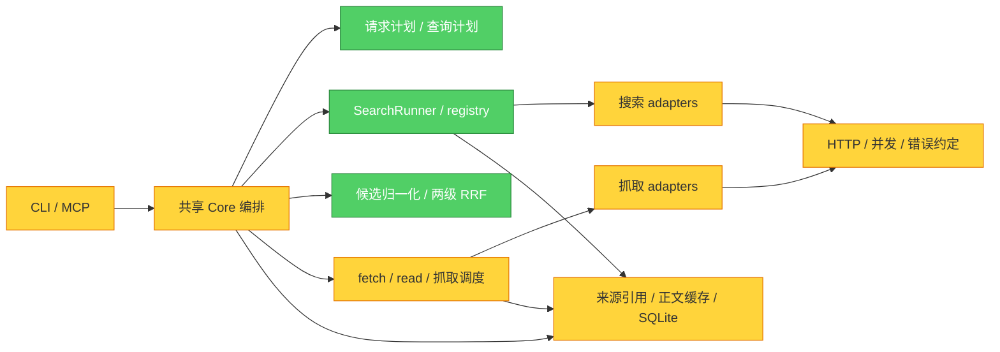

# 第三轮全仓审查 · 2026-09-12

审查基线：`eb2d5cdeb222b52060c4509c45a22aff4ce911fa`。覆盖第二轮 8 项修复合并后的完整代码。**评价：一般；共享 Core 和模块拆分可以继续使用，仍有 7 个确认的 P2 问题。值得局部修复，没有整体重写或拆服务的依据。**

本报告把可复现缺陷与结构建议分开；严重程度由主 Session 按实际触发条件和影响校准，未确认 P0/P1。仅新增审查材料，未修改业务代码或正式测试。

## 模块依赖图

Architecture Audit。对 60 个第一方 Python 模块（其中 52 个非 `__init__` 模块）重新进行 AST 检查，解析相对导入及函数内导入，得到 142 条显式内部导入边；Tarjan SCC 未发现多模块循环。动态字符串导入不在该结论中。下图为职责概图，精确边见本地 `architecture.json`。

颜色仅表示本次是否有对应发现，不是量化健康分。团队结构未知，未作 Conway 推断。

## 已确认缺陷

### R3-01 · P2：GitHub 限流被累计成永久无效 token

- **位置：** [github.py:57](../multi_search_mcp/src/search/searchers/github.py#L57)，分类在 [key_state.py:282](../multi_search_mcp/src/state/key_state.py#L282)。
- **触发与根因：** GitHub primary/secondary 限流允许使用 HTTP 403；响应头及正文能表达限流原因。adapter 捕获异常后只留下 `HTTP Error 403: Forbidden`，丢失这些信息，key manager 因而按 invalid 记账。[GitHub 官方限流协议](https://docs.github.com/en/rest/using-the-rest-api/rate-limits-for-the-rest-api)
- **复现：** 真实 GitHub adapter → keyed runner → 临时 SQLite，模拟 403、`x-ratelimit-remaining: 0` 及限流 message；模拟每次冷却到期后三次尝试得到 `transient_invalid/1 → transient_invalid/2 → invalid/3`，此后候选 key 列表为空。
- **最小方向：** adapter 有界读取 HTTPError body，结合 headers/message 显式标记 rate_limit。真正认证拒绝保留现有行为，不把全部 403 一概视作限流。验收 primary/secondary 限流、权限拒绝、401/429 对照以及冷却后可恢复。

### R3-02 · P2：部分状态工具仍会阻塞整个 MCP 事件循环

- **位置：** [server.py:181](../multi_search_mcp/server.py#L181)，同类还有 `read_source`、带状态选项的 `list_sources`、key/site 查询及修改工具；[state_store.py:164](../multi_search_mcp/src/state/state_store.py#L164)。
- **触发与根因：** 上述工具仍同步执行。每次创建 StateStore 都进行迁移并申请 `BEGIN IMMEDIATE` 写锁，SQLite 连接等待上限为 10 秒；只读状态请求也可能先等写锁。
- **复现：** 临时库由独立线程持有 350ms 写锁，调用真实 FastMCP 的 `get_key_status` 和 `read_source`。预定 10ms 后恢复的 asyncio sentinel 实际延迟约 **448ms / 451ms**；工具最后虽成功，同期事件循环被卡住。第二轮修复 doctor 不覆盖这些入口。
- **最小方向：** 有状态/I/O 的 MCP 工具使用既有有界 `_run_tool`；无状态 `list_sources` 可保留直接返回。验收写锁下轻量请求和取消仍可处理，同时不提前释放尚在执行的池容量。

### R3-03 · P2：非连续认证失败仍会累积至永久 invalid

- **位置：** [key_state.py:215](../multi_search_mcp/src/state/key_state.py#L215)。
- **触发与根因：** 已有规则要求连续 invalid 才升级永久无效，但 rate_limit 和 quota_exhausted 分支保留旧 `invalid_strikes`；只有成功及最后通用失败分支清零。
- **复现：** 真实 SQLiteKeyManager 依次记录 `invalid → rate_limit → invalid → quota_exhausted → invalid`，计数为 **1、1、2、2、3**，最终永久 invalid。序列可来自冷却期到期重试或并发在途请求的回报，不表示冷却期内可以继续立即发请求。
- **最小方向：** 非 invalid 的 provider 失败默认清零，invalid 分支继续使用现有原子 SQL 累加；明确的 target 错误继续保持中立。补混合序列与并发提交顺序，保留三个真正连续 invalid 的升级测试。这与 R3-01 的 adapter 误分类是两个独立根因。

### R3-04 · P2：Firecrawl 目标网页错误会清除另一请求的 key 冷却

- **位置：** [firecrawl.py:53](../multi_search_mcp/src/scrape/scrapers/firecrawl.py#L53)；HTTP 200 失败包的解析也没有保留来源。
- **触发与根因：** Firecrawl 官方用 HTTP 500 加 `SCRAPE_SSL_ERROR` 表达目标页面证书错误。adapter 丢弃 HTTPError body 中的 code，目标失败变成普通 provider error，进入 key 健康更新。[Firecrawl 官方错误码](https://docs.firecrawl.dev/api-reference/introduction)
- **复现：** 一次已发起的抓取返回前，模拟另一请求写入真实 rate_limit。随后目标站点失败返回，真实 `run_scrape` 将 key 从 **cooldown 改回 active**，清空冷却时间；目标原因也消失。
- **最小方向：** 有界解析已知目标错误 code，标记 `error_origin=target,error_type=target`，复用现有中立处理；未知 5xx 不猜测成 target。验收目标错误不覆盖已有健康状态，真实 401/402/429 仍按 provider 错误处理。

### R3-05 · P2：1 秒抓取预算在进入后端前被截成 0

- **位置：** [service.py:638](../multi_search_mcp/src/service.py#L638) 将浮点剩余时间传给抓取请求，[service.py:800](../multi_search_mcp/src/service.py#L800) 又通过整数配置解析截断。
- **复现：** 同一即时成功的模拟 Jina 后端，经真实 `run_search_web` 调用：`scrape_timeout=1` 时后端调用 **0 次**、正文成功 **0 条**，返回 `scrape deadline exceeded`；设为 2 秒则调用 **1 次**、成功 **1 条**。第一种情况下真实剩余时间仍大于 0。
- **影响：** 1 秒配置系统性失败；其他预算也会丢掉不足 1 秒的余量，接近批次截止时尤其明显。
- **最小方向：** 区分用户配置的整数秒与运行时浮点剩余预算，内部执行保留精度，并继续受绝对 deadline 约束。测试预算 1 秒、剩余不足 1 秒、已经耗尽三种情况。

### R3-06 · P2：DNS 阶段不受 HTTP 总 deadline 约束

- **位置：** [http.py:93](../multi_search_mcp/src/support/http.py#L93)，以及 [url_security.py:65](../multi_search_mcp/src/support/url_security.py#L65) 的同步解析。
- **触发与根因：** socket 连接 timeout 没有约束其内部 `getaddrinfo`；当前只有解析/连接返回后才重新核对预算，URL 安全预检也未接收 deadline。
- **复现：** `urlopen_retry(timeout=0.01)` 内模拟 DNS 阻塞 0.08 秒后报错，实际 **0.0807 秒**才返回；无真实 DNS、TCP 或 provider 调用。
- **影响边界：** 外层 SearchRunner 仍可按自己的截止时间返回；滞留的 provider/fetch worker 不能及时释放，直接 Core fetch/doctor 也可能越过预期预算。这里确认的是超时覆盖缺口，**未证明 SSRF 绕过**。
- **最小方向：** 将解析放入有限容量、按 deadline 停止等待的边界，明确尚未返回解析任务的生命周期；安全预检与实际连接共同扣除预算。不能用每次启动无限线程解决。验收慢解析后及时返回、不再发 TCP/TLS、解析结束可释放容量。

### R3-07 · P2：导入库会覆盖宿主进程的全局 urllib 配置

- **位置：** [http.py:172](../multi_search_mcp/src/support/http.py#L172)。
- **触发与根因：** 宿主已配置 urllib 的 Cookie、认证或自定义 handler，再导入本库时，模块无条件 `install_opener(_shared_opener)`，替换整个进程的 opener。
- **复现：** 在独立子进程安装只返回内存字节的 `probe://` handler；导入前同一调用返回 `local-ok`，导入后变为 `URLError: unknown url type: probe`，全局对象确已更换。零网络，不污染审查进程。
- **最小方向：** 移除导入时的全局安装；`urlopen_retry` 已显式调用自己的 `opener.open`，不需要另造 HTTP 路径。验收宿主行为不变，并保留本库重定向、凭据和 deadline 防护。

## 架构、代码质量及其他方面

| 方面 | 当前判断 | 值得做的最小改进 |
|---|---|---|
| 模块结构与依赖 | 搜索/抓取 adapter、候选融合、状态存储边界可用；显式导入无循环。registry 引用 runner 的类型未造成已知故障 | 保留现有分层；不因文件大、类少或类型依赖而重写 |
| Core 职责 | service.py 为 1093 行、21 个直接模块依赖；长度本身不是 bug。兼容入口、候选执行、抓取阶段重复解析计划和默认值 | 一次生成内部执行计划并传递；公共 dataclass/工具签名保持兼容，multi_search 主要负责兼容呈现 |
| 错误模型 | 已有 target/provider、error_type、KeyOutcome，却未在全部 adapter 保留协议信息；R3-01/04 是后果 | 先修受影响 adapter 的结构化错误；共享分类器不应继续猜测被截短的字符串 |
| 时间模型 | 用户配置整数秒、浮点剩余预算、绝对 deadline 混用；R3-05/06 是后果 | 在解析边界决定配置；内部统一传递截止时间和精确剩余预算 |
| 状态与事务 | SQLite 适合当前规模；每次初始化迁移会增加写锁竞争。抓取明细及聚合统计分多个事务写入 | 将初始化迁移与日常连接分离；将一次抓取记录及统计更新放进同一事务。此处是结构建议，不等同已确认统计丢失 |
| 缓存与内容契约 | 检查了 source 绑定、内容 hash、TTL、URL 权限 scope、容量与共享对象淘汰；本轮未确认额外缓存缺陷 | 保留现有来源引用/正文/评测快照的区分；历史完整 URL 的留存策略仍是待明确的设计问题 |
| 并发 | 已有有界池与任务引用清理可继续使用；没有确认第二轮引用修复失效 | 补全 I/O 入口分发和解析预算，不新增无界后台任务 |
| 测试质量 | 576 项回归通过，却没有覆盖本轮协议/锁竞争/导入副作用；HTTP/DNS guard 仍分散 | 在公共测试入口默认隔离外网和真实凭据，明确允许本地协议服务；拦截实际 opener/连接边界，不能只 patch urllib.request.urlopen |
| 安全 | 保留 URL 与重定向限制、脱敏路径；未建立新的 SSRF/凭据泄露漏洞证据 | 先消除全局 HTTP 副作用并补 deadline；不将未验证的可能性写成漏洞 |
| 打包与 CI | 非 editable 安装、仓库外 smoke、Windows/Linux × Python 3.10/3.14 矩阵已有配置；未发现本轮新打包阻塞 | 当前审查未运行远程矩阵，不把配置存在视作已通过 |
| 文档与维护 | 概念及公共正文字段已有明确契约；部分 glossary 代码位置/数量描述仍会随实现漂移 | 修复时同步相关约定；避免为了让测试通过而改写用户语义 |

执行计划重复解析的具体位置：[service.py:701](../multi_search_mcp/src/service.py#L701)、[service.py:365](../multi_search_mcp/src/service.py#L365)、[service.py:629](../multi_search_mcp/src/service.py#L629)。测试入口目前只统一隔离状态路径：[run_tests.py:13](../scripts/run_tests.py#L13)。建议围绕这些已有接口做小调整，而非把 service 拆成许多只转发参数的类。

## 验证与范围

- 主 Session 独立复跑 provider、状态、接口和架构探针，得到上述观测；模拟 HTTP、合成 key、临时 SQLite，未调用真实 provider 或读取生产状态。
- 当前完整回归：`.venv/Scripts/python.exe -B -X utf8 scripts/run_tests.py` → **576 tests in 28.548s, OK，exit code 0**。测试通过不否定定向失败证据。
- [接口探针](../.scratch/audit-round3-20260912/interface_probe.py)及[结果](../.scratch/audit-round3-20260912/interface_results.json)、[provider 探针](../.scratch/audit-round3-20260912/providers_probe.py)、[状态探针](../.scratch/audit-round3-20260912/state_probe.py)、[架构探针](../.scratch/audit-round3-20260912/architecture_probe.py)及[结果](../.scratch/audit-round3-20260912/architecture.json)保存在被 Git 忽略的本地审查目录。它们用于确认当前缺陷，不能当作修复后的 PASS 回归。
- 覆盖所有第一方模块的静态依赖，重点代码路径由三个独立审查分工及主 Session 复核；不是形式化证明或生产负载测试。当前环境 Windows / Python 3.13；没有声称跨平台、真实搜索质量或生产验收完成。
- Brooks 附属共享模板在本地缺失；使用已读取的 architecture-guide 检查依赖、领域边界、重复知识、复杂度、修改影响和测试替换接口，未生成虚构健康分或未读书籍引用。

优先处理 R3-01/02/03/04/05；R3-07 可以独立小改。R3-06 涉及共享网络执行边界，应单独设计和验收。请求计划与测试隔离的结构改进可随后进行。本轮没有实施这些修复。
